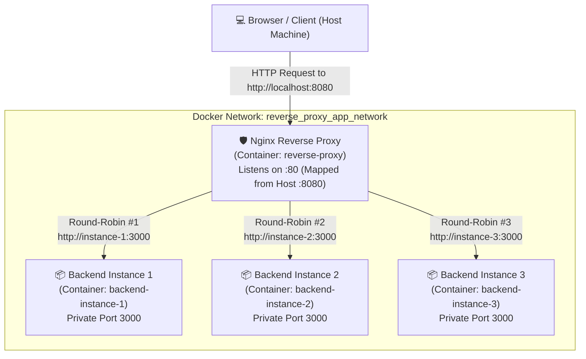

# Docker Nginx Reverse Proxy & Load Balancer Hands-on Project

A beginner-friendly, practical guide and reference implementation demonstrating how **Nginx** acts as a reverse proxy and load balancer in front of multiple **Node.js Express** backend instances running in Docker containers.

---

## Architecture Diagram



### Port Mapping Explained

- **Host Port `8080`**: The port exposed on your local computer. When you open `http://localhost:8080` in your browser or run `curl http://localhost:8080`, your computer directs that traffic to Docker.
- **Nginx Container Port `80`**: The internal port inside the Nginx container. Docker forwards traffic arriving at host port `8080` to port `80` inside the Nginx container (`8080:80`).
- **Backend Internal Port `3000`**: Each Node.js container listens on port `3000`. **This port is NOT exposed on the host**. Only containers on the shared Docker bridge network (`reverse_proxy_app_network`) can communicate with port `3000`.

---

## Core Concepts Explained Simply

### 1. What is a Client?
A **client** is any application or device that initiates a request over a network. Examples include your web browser (Chrome, Edge, Firefox), a mobile app, or a terminal command-line tool like `curl`. The client asks for a resource (such as a webpage or JSON data) and waits for a response.

### 2. What is a Server?
A **server** is a computer or software program that listens for incoming network requests from clients, processes the requests, and returns an appropriate response (such as HTML, JSON, or an error status code). In this project, each Node.js Express process is an HTTP application server.

### 3. What is a Reverse Proxy?
A **proxy** typically sits in front of clients to route outbound traffic to the internet. A **reverse proxy**, by contrast, sits in front of **servers** to receive inbound traffic from clients and route it to the appropriate backend server. 
Clients only communicate with the reverse proxy; they have no direct knowledge of, or direct network connection to, the backend servers running behind it.

### 4. Why is Nginx Used in this Project?
**Nginx** is a high-performance, battle-tested HTTP web server, reverse proxy, and load balancer. In this project, Nginx serves as the single public entry point:
- It terminates client connections on port `80`.
- It distributes incoming HTTP requests across all three Node.js backend instances.
- It attaches standard tracking headers (`X-Forwarded-For`, `X-Real-IP`, `X-Forwarded-Proto`).
- It monitors backend health and automatically reroutes requests if an instance fails.

### 5. Why is Docker Used?
**Docker** packages applications and all their dependencies (Node.js runtime, libraries, environment variables) into lightweight, portable, isolated environments called **containers**. 
Using Docker ensures that:
- The project runs identically across Windows, macOS, and Linux without needing to configure Node.js or Nginx locally.
- Multiple identical backend instances can run side-by-side on the same machine without port conflicts.

### 6. How Docker Compose Connects the Containers
**Docker Compose** is a tool for defining and running multi-container Docker applications using a single YAML configuration file (`docker-compose.yml`).
When Compose starts:
1. It automatically provisions a user-defined bridge network (`reverse_proxy_app_network`).
2. It attaches all four containers (`reverse-proxy`, `backend-instance-1`, `backend-instance-2`, and `backend-instance-3`) to this network.
3. It enables Docker's internal DNS resolver (`127.0.0.11`), allowing containers to discover and talk to each other using their service names (`http://instance-1:3000`, etc.) instead of hard-coded IP addresses.

### 7. Why Backend Containers Do Not Need Public Ports
Security and clean architecture:
- In production, backend application servers should never be directly accessible from the public internet. Exposing them invites attacks, unauthorized traffic, and port management headaches.
- Because Nginx and the Node.js instances reside on the same private Docker network, Nginx can reach `instance-1:3000`, `instance-2:3000`, and `instance-3:3000` privately.
- By omitting `ports:` and using only `expose: ["3000"]` for the backend services in `docker-compose.yml`, Docker keeps port `3000` completely blocked from the outside host machine.

### 8. How Nginx Forwards Requests to the Backend
When a client sends an HTTP request:
1. The request reaches `http://localhost:8080`.
2. Docker directs the request to port `80` of the `nginx` container.
3. Nginx inspects the route according to `nginx.conf`:
   - If the request is for `/nginx-health`, Nginx answers directly with proxy health status.
   - For all other paths (`/`, `/health`, `/info`), `proxy_pass http://node_backend;` forwards the request.
4. Nginx injects headers such as `X-Real-IP` (the client's actual IP) and `Host`, opens an HTTP connection to the selected backend instance, receives the response, and sends it back to the client.

### 9. How Load Balancing Works
Load balancing distributes incoming network traffic across a group of backend servers. This project uses Nginx's default load balancing strategy: **Round Robin**.
- Request 1 is forwarded to `instance-1`.
- Request 2 is forwarded to `instance-2`.
- Request 3 is forwarded to `instance-3`.
- Request 4 cycles back to `instance-1`, and the cycle repeats.

Other common algorithms supported by Nginx include:
- `least_conn`: Sends the request to the backend with the fewest active connections.
- `ip_hash`: Uses a hash of the client's IP address to ensure requests from the same client always land on the same backend (useful for session affinity).

### 10. What Happens When a Backend Instance Becomes Unavailable?
In this project, Nginx is configured with high-availability directives:
```nginx
server instance-1:3000 max_fails=3 fail_timeout=10s;
proxy_next_upstream error timeout http_502 http_503 http_504;
proxy_next_upstream_tries 3;
proxy_next_upstream_timeout 10s;
```
If `instance-2` is stopped or crashes:
1. When Nginx attempts to route a request to `instance-2`, the connection fails or times out.
2. Rather than returning an error to the user, `proxy_next_upstream` causes Nginx to immediately retry the request against the next healthy instance (`instance-3` or `instance-1`).
3. Nginx increments the failure count for `instance-2`. Once `max_fails` is reached, Nginx marks `instance-2` as down for `fail_timeout` (10 seconds), omitting it from rotation.
4. The client receives a successful `HTTP 200` response without disruption!
5. When `instance-2` comes back online, Nginx resumes sending traffic to it automatically.

---

## Project Structure

```
docker-reverse-proxy/
├── app/
│   ├── Dockerfile             # Multi-stage/production Node.js 20 Alpine image
│   ├── .dockerignore          # Excludes node_modules, git, and local logs from build
│   ├── package.json           # Node.js dependencies (Express) and npm start script
│   └── server.js              # Express app listening on port 3000 with /, /health, /info
├── nginx/
│   └── nginx.conf             # Nginx reverse proxy, logging, upstreams & proxy headers
├── docker-compose.yml         # Defines nginx proxy and 3 backend instances on shared bridge network
├── .gitignore                 # Standard git ignores
└── README.md                  # Project documentation & hands-on exercises
```

---

## Quick Start Guide

### Prerequisites
- [Docker Desktop](https://www.docker.com/products/docker-desktop/) installed and running.
- `docker compose` v2 or later.
- `curl` or a modern web browser.

### 1. Start the Project

Open a terminal in this project directory:

```bash
docker compose up -d --build
```

You should see:
```text
✔ Network reverse_proxy_app_network  Created
✔ Container backend-instance-1       Started (healthy)
✔ Container backend-instance-2       Started (healthy)
✔ Container backend-instance-3       Started (healthy)
✔ Container reverse-proxy            Started (healthy)
```

### 2. Check Running Containers and Status

```bash
docker compose ps
```

Expected output:
```text
NAME                 IMAGE                 COMMAND                  SERVICE      STATUS                    PORTS
backend-instance-1   node-backend:latest   "docker-entrypoint.s…"   instance-1   Up (healthy)              3000/tcp
backend-instance-2   node-backend:latest   "docker-entrypoint.s…"   instance-2   Up (healthy)              3000/tcp
backend-instance-3   node-backend:latest   "docker-entrypoint.s…"   instance-3   Up (healthy)              3000/tcp
reverse-proxy        nginx:alpine          "/docker-entrypoint.…"   nginx        Up (healthy)              0.0.0.0:8080->80/tcp
```

Notice how `backend-instance-*` containers only have `3000/tcp` (internal), while only `reverse-proxy` has `0.0.0.0:8080->80/tcp` published.

---

## Verification & Hands-On Exercises

### Exercise 1: Test the Endpoints

#### Root Endpoint (`/`)
Sends a request to the reverse proxy, which forwards it to a backend instance:
```bash
curl http://localhost:8080/
```
Output:
```text
Hello World from instance-1
```

#### Health Status Endpoint (`/health`)
Returns JSON health status from the handling instance:
```bash
curl http://localhost:8080/health
```
Output:
```json
{
  "status": "UP",
  "instance": "instance-2",
  "hostname": "6a9f3fe2209d",
  "uptimeSeconds": 55,
  "timestamp": "2026-10-23T03:19:45.284Z"
}
```

#### Metadata & Forwarded Headers Endpoint (`/info`)
Demonstrates that Nginx successfully forwarded request headers:
```bash
curl http://localhost:8080/info
```
Output:
```json
{
  "instance": "instance-3",
  "hostname": "ac82591e450c",
  "pid": 18,
  "nodeVersion": "v20.20.2",
  "platform": "linux",
  "uptimeSeconds": 64,
  "environment": {
    "NODE_ENV": "production",
    "PORT": 3000
  },
  "headers": {
    "host": "localhost",
    "x-real-ip": "172.20.0.1",
    "x-forwarded-for": "172.20.0.1",
    "x-forwarded-proto": "http"
  }
}
```

#### Nginx Proxy Health Endpoint (`/nginx-health`)
Demonstrates direct responses from the proxy:
```bash
curl http://localhost:8080/nginx-health
```
Output:
```json
{"status":"UP","service":"nginx-reverse-proxy"}
```

---

### Exercise 2: Observe Round-Robin Load Balancing

Send repeated requests to observe how Nginx rotates between backend instances:

**On Linux / macOS (Bash):**
```bash
for i in {1..6}; do
  curl -s http://localhost:8080/
done
```

**On Windows (PowerShell):**
```powershell
1..6 | ForEach-Object { curl.exe -s http://localhost:8080/ }
```

**Observed Output:**
```text
Hello World from instance-1
Hello World from instance-2
Hello World from instance-3
Hello World from instance-1
Hello World from instance-2
Hello World from instance-3
```

Notice the pattern: every consecutive request lands on the next backend instance!

---

### Exercise 3: Verify Network Isolation

Try connecting directly to port 3000 on your host machine:

```bash
curl --connect-timeout 2 http://localhost:3000/
```

**Result:** The connection fails or times out (`Failed to connect to localhost port 3000`). This confirms that backend containers are shielded from external direct access.

---

### Exercise 4: Test Fault Tolerance & Failover

1. Stop one of the backend instances:
   ```bash
   docker compose stop instance-2
   ```

2. Send multiple requests:
   ```powershell
   1..6 | ForEach-Object { curl.exe -s http://localhost:8080/ }
   ```
   **Observed Output:**
   ```text
   Hello World from instance-3
   Hello World from instance-1
   Hello World from instance-3
   Hello World from instance-1
   Hello World from instance-3
   Hello World from instance-1
   ```
   *Notice: Nginx automatically detected that `instance-2` was down and rerouted all traffic between `instance-1` and `instance-3` without failing any request.*

3. Bring `instance-2` back up:
   ```bash
   docker compose start instance-2
   ```

4. Wait 5 seconds, then send requests again:
   ```powershell
   1..6 | ForEach-Object { curl.exe -s http://localhost:8080/ }
   ```
   *Notice: `instance-2` automatically rejoins the round-robin rotation.*

---

## Inspecting Logs

View unified logs across all containers:
```bash
docker compose logs -f
```

View only Nginx access logs to see which upstream served which request:
```bash
docker compose logs -f nginx
```

Example log line:
```text
reverse-proxy | 172.20.0.1 - - [23/Oct/2026:03:22:15 +0000] "GET / HTTP/1.1" 200 28 upstream: 172.20.0.4:3000 (0.002 s) host: "localhost:8080" user_agent: "curl/8.21.0"
```

View logs for a single backend instance:
```bash
docker compose logs -f instance-1
```

---

## Stopping and Cleaning Up

Stop all containers and remove the Docker network:
```bash
docker compose down
```

To stop containers, remove the network, and delete the built images:
```bash
docker compose down --rmi local
```
